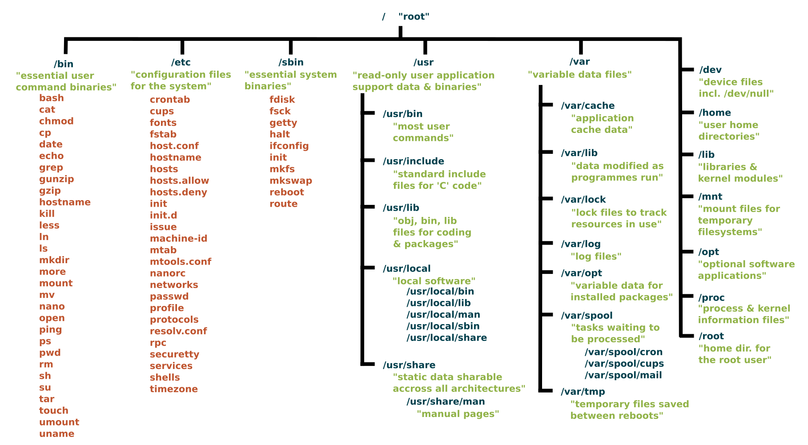

# 🛡 Session 5 – System Administration Basics

**Duration:** 90–120 minutes

**Theme:** From user to administrator

> ⚠️ Use your own training VM. Commands in this session change system configuration. Never practise them on a shared or production server.

---

# 🎯 Objectives

By the end of this session you should be able to:

- Explain the role of `root` and use `sudo` responsibly
- Create, modify and delete users
- Manage groups and set up a shared team folder
- Grant limited admin rights with the sudoers file
- Navigate the Linux filesystem hierarchy
- Understand disks, partitions and filesystems
- Inspect disks and mount points safely
- Mount and unmount a filesystem

---

# 👑 1. root & sudo

`root` is the superuser (UID `0`). It can do **anything** – including destroying the system.

Good practice: work as a normal user and borrow root power only when needed.

```bash
sudo apt update          # run ONE command as root
sudo -i                  # open a root shell (exit to leave)
su - alice               # switch to another user (asks for alice's password)
sudo su - alice          # switch to alice using YOUR sudo rights
whoami                   # who am I right now?
exit
```

> *Prompt hint*: `$` = normal user · `#` = root

Every `sudo` call is logged:

```bash
sudo grep sudo /var/log/auth.log | tail
```

---

# 👤 2. Users

## Where users live

```bash
cat /etc/passwd
```

```
alice:x:1001:1001:Alice Smith:/home/alice:/bin/bash
  │   │  │    │       │           │          │
  │   │  │    │       │           │          └── login shell
  │   │  │    │       │           └───────────── home directory
  │   │  │    │       └───────────────────────── description
  │   │  │    └───────────────────────────────── primary group ID (GID)
  │   │  └────────────────────────────────────── user ID (UID)
  │   └───────────────────────────────────────── password is in /etc/shadow
  └───────────────────────────────────────────── user name
```

Remember `cut` from Session 2?

```bash
cut -d: -f1 /etc/passwd                        # all user names
awk -F: '$3 >= 1000 {print $1}' /etc/passwd    # human users only
```

- UID `0` → root
- UID `1–999` → system/service accounts
- UID `1000+` → humans

Passwords are hashed in `/etc/shadow`, readable only by root:

```bash
sudo tail -3 /etc/shadow
```

## Who am I?

```bash
id                 # my UID, GID and groups
id alice           # someone else's
who                # who is logged in now
last | head        # recent logins
```

## Create users

| Command                  | Style                                          |
| ------------------------ | ---------------------------------------------- |
| `sudo adduser bob`       | Friendly, interactive (Ubuntu/Debian). Creates home, asks for password |
| `sudo useradd -m -s /bin/bash bob` | Low-level, scriptable. Nothing is assumed |

```bash
sudo adduser bob

sudo useradd -m -s /bin/bash -c "Carol Jones" carol
sudo passwd carol
```

## Modify users

```bash
sudo usermod -c "Bob Builder" bob     # change description
sudo usermod -s /bin/zsh bob          # change shell
sudo usermod -L bob                   # lock account
sudo usermod -U bob                   # unlock account
sudo passwd -e bob                    # force password change at next login
```

## Delete users

```bash
sudo userdel bob          # keeps /home/bob
sudo userdel -r bob       # also deletes /home/bob and mail
```

---

# 👥 3. Groups

Groups let you give permissions to **teams**, not individuals.

```bash
cat /etc/group
groups              # my groups
groups alice
getent group sudo   # members of the sudo group
```

## Manage groups

```bash
sudo groupadd analysts
sudo usermod -aG analysts alice      # add alice to analysts
sudo gpasswd -d alice analysts       # remove alice from analysts
sudo groupdel analysts               # delete group
```

> ⚠️ **Never forget the `-a`**
> 
> `usermod -G analysts alice` **replaces** all of alice's groups with `analysts` – she may lose `sudo`!
> 
> `usermod -aG analysts alice` **appends**.

New group membership applies at the **next login**. To test immediately:

```bash
su - alice
id
```

## Shared team folder

Back to permissions from Session 1 – now with two special bits.

```bash
sudo mkdir -p /srv/analysts
sudo chgrp analysts /srv/analysts
sudo chmod 2770 /srv/analysts
ls -ld /srv/analysts
```

```
drwxrws--- 2 root analysts 4096 Oct 15 10:00 /srv/analysts
      ^
      └── s = setgid
```

| Special bit | Octal | On a directory                                                   |
| ----------- | ----- | ---------------------------------------------------------------- |
| **setgid**  | `2`   | New files inherit the **folder's group** instead of the creator's |
| **sticky**  | `1`   | Only the **owner** of a file can delete it                       |

Look at `/tmp`:

```bash
ls -ld /tmp
drwxrwxrwt ... /tmp      # t = sticky: everyone can write, nobody deletes others' files
```

---

# 📜 4. The sudoers File

Who can use `sudo`, and for what, is defined in `/etc/sudoers`.

> ⚠️ **Never edit it with a normal editor.** A syntax error can lock everyone out of `sudo`.
> 
> Always use `visudo`, which checks the syntax before saving.

```bash
sudo visudo
```

## Syntax

```
who    where=(as_whom)    what
root   ALL=(ALL:ALL)      ALL
%sudo  ALL=(ALL:ALL)      ALL
```

- `%` means **group**
- `ALL` means "anything"

On Ubuntu, being in the `sudo` group = full admin:

```bash
sudo usermod -aG sudo alice
```

## Drop-in files (recommended)

Instead of editing the main file, add small files in `/etc/sudoers.d/`:

```bash
sudo visudo -f /etc/sudoers.d/analysts
```

```
# Analysts may read system logs and restart cron, nothing else
%analysts ALL=(root) /usr/bin/journalctl, /usr/bin/systemctl restart cron
```

- Use **full paths** to commands (`which journalctl`)
- File name: no dots, no `~`

Check it:

```bash
sudo visudo -c                 # validate all sudoers files
sudo -l -U alice               # what can alice run?
su - alice
sudo -l                        # as alice
```

## NOPASSWD

```
deploy ALL=(root) NOPASSWD: /usr/bin/systemctl restart myapp
```

Useful for automation. Dangerous if used with `ALL`. Keep it as narrow as possible.

---

# 🌳 5. The Filesystem Hierarchy

Windows has `C:\`, `D:\`… Linux has **one single tree** starting at `/`. Every disk, USB stick or network share is attached somewhere inside that tree.



Folders you will meet as an admin:

| Folder         | Content                                         |
| -------------- | ----------------------------------------------- |
| `/etc`         | Configuration (`passwd`, `group`, `sudoers`, `fstab`) |
| `/home`        | User home folders                               |
| `/root`        | Home of the root user                           |
| `/var/log`     | Logs                                            |
| `/dev`         | Devices – including disks (`/dev/sda`)          |
| `/mnt`, `/media` | Mount points for extra disks / USB            |
| `/proc`, `/sys`| Live kernel information (not real files on disk)|
| `/srv`         | Data served by this system                      |
| `/opt`         | Optional third-party software                   |

---

# 💽 6. Disks, Partitions & Filesystems

## From disk to folder

```
Physical disk  →  Partition table  →  Partitions  →  Filesystem  →  Mount point
 /dev/sda           GPT                /dev/sda1        ext4            /
                                       /dev/sda2        ext4            /home
                                       /dev/sda3        swap            (none)
```

## Device names

| Name              | Type                                   |
| ----------------- | -------------------------------------- |
| `/dev/sda`, `sdb` | SATA/SCSI/USB disks (a, b, c…)         |
| `/dev/sda1`       | First partition of `sda`               |
| `/dev/nvme0n1`    | First NVMe SSD                         |
| `/dev/nvme0n1p1`  | First partition of that NVMe           |
| `/dev/vda`        | Virtual disk (many cloud VMs)          |
| `/dev/loop0`      | A file pretending to be a disk (snaps) |

## Partition tables

|                     | MBR (old)     | GPT (modern)          |
| ------------------- | ------------- | --------------------- |
| Max disk size       | 2 TB          | Practically unlimited |
| Max partitions      | 4 primary     | 128                   |
| Boot mode           | BIOS          | UEFI                  |

## Common filesystems

| Filesystem | Used for                                         |
| ---------- | ------------------------------------------------ |
| `ext4`     | Default for Linux                                |
| `xfs`      | Large files, servers (default on RHEL)           |
| `vfat`     | USB sticks, EFI boot partition, Windows-compatible |
| `ntfs`     | Windows disks                                    |
| `swap`     | Not a filesystem – extra "memory" on disk        |
| `tmpfs`    | Lives in RAM, gone after reboot                  |

---

# 🔍 7. Inspecting Disks (read-only)

These commands **only look**. Nothing is changed.

```bash
lsblk                  # tree of disks and partitions
lsblk -f               # + filesystem type, UUID, mount point
sudo blkid             # UUIDs and types
sudo fdisk -l          # partition tables (just -l = list!)
df -h                  # free space per mounted filesystem
df -hT                 # + filesystem type
du -sh /var/log        # size of a folder
sudo du -sh /var/* 2>/dev/null | sort -h   # what is eating my disk?
free -h                # RAM and swap
swapon --show          # active swap
```

> ⚠️ `fdisk` **without** `-l` opens an interactive editor that can wipe partitions. Not today.

---

# 🔗 8. Mounting

**Mounting** = attaching a filesystem to a folder of the tree.

## What is mounted now?

```bash
findmnt                 # tree view
findmnt /               # what is mounted on /
mount | column -t       # classic view
```

## Mount & unmount

```bash
sudo mount /dev/sdb1 /mnt/data        # attach
sudo umount /mnt/data                 # detach (umount, not unmount!)
```

## Safe hands-on: a RAM disk

`tmpfs` lives in memory. It cannot damage any disk.

```bash
sudo mkdir -p /mnt/demo
sudo mount -t tmpfs -o size=50M tmpfs /mnt/demo
df -h /mnt/demo
findmnt /mnt/demo

sudo touch /mnt/demo/hello.txt
ls /mnt/demo

sudo umount /mnt/demo
ls /mnt/demo           # empty – the data lived only in RAM
```

## "target is busy"

```bash
cd /mnt/demo
sudo umount /mnt/demo         # umount: /mnt/demo: target is busy
sudo lsof +D /mnt/demo        # who is using it?
sudo fuser -vm /mnt/demo      # alternative
cd ~                          # leave the folder, then retry
```

## Permanent mounts: /etc/fstab

Mounts disappear after a reboot. `/etc/fstab` lists what to mount at boot.

```bash
cat /etc/fstab
```

```
# <device>                                 <mount point> <type> <options>        <dump> <pass>
UUID=3f2a...-...-9c1e                      /             ext4   defaults          0      1
UUID=8b7d...-...-11aa                      /data         ext4   defaults,nofail   0      2
tmpfs                                      /mnt/demo     tmpfs  size=50M          0      0
```

| Field       | Meaning                                                   |
| ----------- | --------------------------------------------------------- |
| device      | Use `UUID=` – names like `/dev/sdb1` can change           |
| mount point | Folder where it appears                                   |
| type        | `ext4`, `xfs`, `vfat`, `tmpfs`…                           |
| options     | `defaults`, `ro`, `noexec`, `nofail` (boot even if missing) |
| dump        | Legacy backup flag – use `0`                              |
| pass        | fsck order: `1` root, `2` others, `0` skip                |

> ⚠️ A wrong line in `/etc/fstab` can stop the machine from booting. After editing, always test with:
> 
> ```bash
> sudo findmnt --verify
> sudo mount -a
> ```

## Adding a new disk (theory only)

What an admin does when a new empty disk arrives:

1. Identify it: `lsblk` (e.g. `/dev/sdb`, no partitions)
2. Partition it: `sudo fdisk /dev/sdb` or `sudo parted /dev/sdb` (create GPT + one partition)
3. Create a filesystem: `sudo mkfs.ext4 /dev/sdb1`
4. Create a mount point: `sudo mkdir /data`
5. Mount it: `sudo mount /dev/sdb1 /data`
6. Get its UUID: `sudo blkid /dev/sdb1`
7. Make it permanent: add a line to `/etc/fstab` with `nofail`
8. Verify: `sudo findmnt --verify && sudo mount -a`

> Steps 2 and 3 **destroy all data** on the target. Triple-check the device name.

---

# 🎓 Congratulations

You now know how to:

- Navigate and transform data like a wizard
- Automate it with scripts and cron
- Administer users, groups, sudo rights and storage

Keep the [cheat sheets](../README.md) close.
